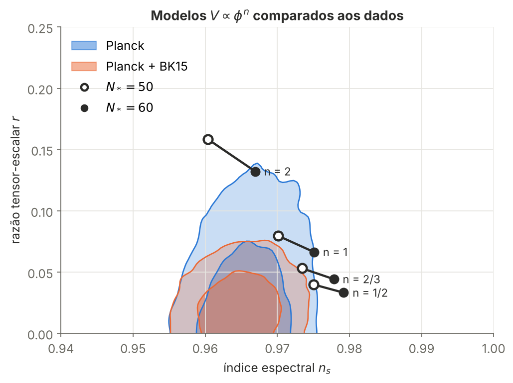
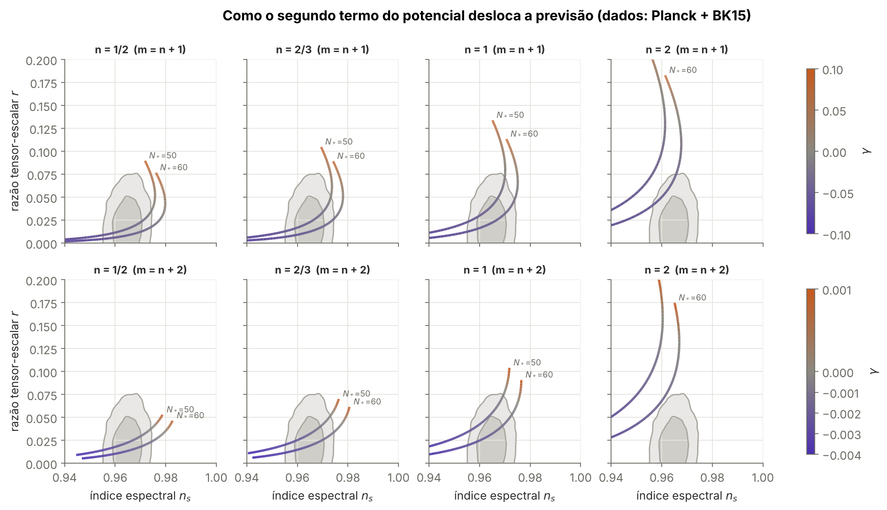

# Os dados do satélite Planck confirmam este modelo do universo primordial?

Análise de dados das cadeias de Monte Carlo públicas da missão espacial **Planck (ESA, 2018)** para testar modelos de **inflação cósmica**. O projeto é baseado no meu artigo publicado na *Physics of the Dark Universe* (2025).

> **English summary:** Data analysis of the public Planck 2018 MCMC chains (≈157k weighted samples) to test polynomial models of cosmic inflation. Weighted statistics, boundary-corrected kernel density estimation, credible regions, and a numerical model solver validated against analytical results. Python · pandas · NumPy · SciPy · Matplotlib · pytest.



## O problema

Logo após o Big Bang, o universo teria passado por uma expansão aceleradíssima, a **inflação cósmica**. Cada modelo de inflação prevê dois números, $n_s$ e $r$, que o satélite Planck mediu. A pergunta é um problema clássico de dados: **dadas as medições, quais modelos (e com quais parâmetros) continuam plausíveis?**

## O que eu fiz

| Etapa | O que foi feito | Ferramentas |
|---|---|---|
| **Engenharia de dados** | leitura de ~265 MB de cadeias brutas, colunas selecionadas pelo nome (não por posição), *burn-in* tratado, extrato compacto de 1,3 MB | pandas, NumPy |
| **Validação** | reprodução dos números oficiais do Planck (médias, desvios e limites de 95%) antes de qualquer conclusão | pandas |
| **Estatística** | estatísticas ponderadas, tamanho efetivo da amostra, estimativa de densidade por kernel (KDE) ponderada com correção de borda, regiões de credibilidade de 68% e 95% | SciPy |
| **Modelagem** | previsões calculadas numericamente (raízes + integração) e conferidas com as fórmulas analíticas do artigo | SciPy |
| **Decisão** | "nota de compatibilidade" objetiva para cada modelo e faixa permitida do parâmetro livre γ | pandas |
| **Qualidade** | 25 testes automáticos (física, estatística e leitura dos dados) | pytest |

## Principais resultados

1. **Reprodução dos números oficiais.** Meus cálculos batem com os arquivos de resumo do próprio Planck, por exemplo: $n_s = 0{,}9659 \pm 0{,}0041$ e $r < 0{,}108$ (Planck); $r < 0{,}061$ (Planck + BICEP/Keck).
2. **Potenciais monomiais ($V \propto \phi^n$):** com o Planck sozinho, 5 de 12 combinações de modelo e $N_*$ são compatíveis (região de 95%). Ao incluir os dados do BICEP/Keck, **nenhuma** é. Essa é a conclusão do artigo, aqui obtida com um critério quantitativo.
3. **Potenciais binomiais ($V \propto \phi^n(1 + \gamma\phi^{m-n})$):** o segundo termo resgata os modelos, mas **só com γ negativo**: cerca de $-0{,}05 < \gamma < -0{,}005$ para $m = n+1$ e $-3\times10^{-3} < \gamma < -10^{-4}$ para $m = n+2$.
4. **O cálculo exato fez diferença.** Nessa faixa de γ, a aproximação analítica de primeira ordem erra mais de 1% (até dezenas de por cento).



## Estrutura

```
├── notebooks/analise_inflacao_planck.ipynb   ← a análise completa, passo a passo
├── src/
│   ├── cadeias_planck.py   leitura das cadeias MCMC (formato CosmoMC)
│   ├── estatistica.py      estatística ponderada, KDE com reflexão, regiões de credibilidade
│   ├── modelos.py          previsões de nₛ e r para potenciais polinomiais
│   └── graficos.py         estilo visual e funções de desenho
├── scripts/preparar_dados.py   gera o extrato compacto a partir dos dados brutos
├── dados/                      extrato (1,3 MB) + instruções para baixar os originais
├── figuras/                    gráficos gerados pelo notebook
└── tests/                      testes automáticos
```

## Como rodar

```bash
pip install -r requirements.txt
pytest                                   # roda os testes
jupyter notebook notebooks/analise_inflacao_planck.ipynb
```

O extrato dos dados já está no repositório. Para recriá-lo a partir dos arquivos originais do Planck, veja [`dados/README.md`](dados/README.md).

## Referências

- M. E. S. Antunes, M. Benetti, E. Bittencourt e **F. A. Franco**, *Constraints on polynomial inflation under power-law perturbations*, Physics of the Dark Universe **48**, 101867 (2025). [doi:10.1016/j.dark.2025.101867](https://doi.org/10.1016/j.dark.2025.101867)
- Planck Collaboration, *Planck 2018 results. X. Constraints on inflation*, A&A 641, A10 (2020).
- Dados: [Planck Legacy Archive / IRSA](https://irsa.ipac.caltech.edu/data/Planck/release_3/ancillary-data/), pacote `COM_CosmoParams_fullGrid_R3.01`.

---

**Fernando de Alvarenga Franco** · Mestrando em Física (Cosmologia), UNIFEI · [LinkedIn](https://www.linkedin.com/in/fernando-franco-256a76341)
